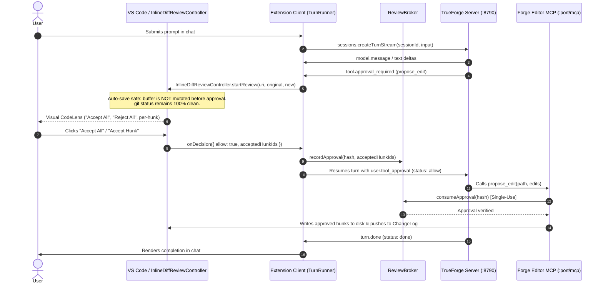

<p align="center">
  
</p>

<h1 align="center">Cline</h1>

<p align="center">
The open source coding agent in your IDE, terminal, & desktop!
</p>

<div align="center">

<div align="center">
<table>
<tbody>
<td align="center">
<a href="https://docs.cline.bot" target="_blank"><strong>Docs</strong></a>
</td>
<td align="center">
<a href="https://discord.gg/cline" target="_blank"><strong>Discord</strong></a>
</td>
<td align="center">
<a href="https://www.reddit.com/r/cline/" target="_blank"><strong>r/cline</strong></a>
</td>
<td align="center">
<a href="https://github.com/cline/cline/discussions/categories/feature-requests?discussions_q=is%3Aopen+category%3A%22Feature+Requests%22+sort%3Atop" target="_blank"><strong>Feature Requests</strong></a>
</td>
<td align="center">
<a href="https://cline.bot/join-us" target="_blank"><strong>Join us!</strong></a>
</td>
</tbody>
</table>
</div>

</div>

<br>

<div align="center">
<table>
<tr>
<td align="center" width="50%">

### CLI

Run Cline in your terminal.
Interactive chat or fully headless 
for CI/CD and scripting.

```
npm i -g cline
```

<a href="./apps/cli/README.md">Learn more</a>
<br><br>

</td>
<td align="center" width="50%">

### Desktop App

Cline as a native app for macOS and Windows.
Run agent sessions in any folder, schedule
routines, and manage models, plugins, and MCP servers.

<a href="https://cline.bot/desktop">Download for macOS and Windows</a>
<br><br>

</td>
</tr>
<tr>
<td align="center" width="50%">

### VS Code Extension

AI coding assistant in your editor.
Create files, run commands, browse the web,
and use tools with human-in-the-loop approval.

<a href="https://marketplace.visualstudio.com/items?itemName=saoudrizwan.claude-dev">Install from VS Marketplace</a>
<br><br>

</td>
<td align="center" width="50%">

### JetBrains Plugin

The same Cline experience in IntelliJ IDEA,
PyCharm, WebStorm, GoLand, and the rest of
the JetBrains family.

<a href="https://plugins.jetbrains.com/plugin/28247-cline">Install from JetBrains Marketplace</a>
<br><br>

</td>
</tr>
</table>
</div>

<div align="center">
<table>
<tr>
<td align="center">

### SDK

Build your own AI agents and integrations powered by the same engine that runs the CLI, desktop app, VS Code extension, and JetBrains plugin. Custom tools, multi-agent teams, connectors, scheduled automations, and more.

```
npm install @cline/sdk
```

<a href="https://docs.cline.bot/cline-sdk/overview">Documentation</a>
<br><br>

</td>
</tr>
</table>
</div>

---

## Index

| Product | Description | Location | CHANGELOG |
|---------|------------|--------------|--------------|
| **SDK** | Node.js programmatic agent API and extension exports. | [`sdk/`](https://github.com/cline/cline/tree/main/sdk) | [CHANGELOG.md](https://github.com/cline/cline/blob/main/sdk/CHANGELOG.md) |
| **CLI** | Terminal UI, headless mode, shell commands, and CLI-specific flows. | [`apps/cli/`](https://github.com/cline/cline/tree/main/apps/cli) | [CHANGELOG.md](https://github.com/cline/cline/blob/main/apps/cli/CHANGELOG.md) |
| **VS Code Extension** | The Marketplace extension and extension host integration. | [`apps/vscode/`](https://github.com/cline/cline/tree/main/apps/vscode) | [CHANGELOG.md](https://github.com/cline/cline/blob/main/CHANGELOG.md) |
| **Desktop App** | Native macOS and Windows app (Tauri shell, Bun sidecar, Next.js UI). | [`apps/examples/desktop-app/`](https://github.com/cline/cline/tree/main/apps/examples/desktop-app) | [CHANGELOG.md](https://github.com/cline/cline/blob/main/apps/examples/desktop-app/CHANGELOG.md) |
| **JetBrains Plugin** | JetBrains-hosted client that talks to the shared agent core. | Currently we are not open-sourcing JetBrains plugins | - |
| **Docs site** | Public documentation pages. | [`docs/`](https://docs.cline.bot/) | - |

## Edits Code Across Your Project

Cline reads your project structure, understands the relationships between files, and makes coordinated changes across your codebase. It monitors linter and compiler errors as it works, fixing issues like missing imports, type mismatches, and syntax errors before you even see them. In VS Code and JetBrains, every edit shows up as a diff you can review, modify, or revert. All changes are tracked with checkpoints, so you can easily undo the agent's work.

## Runs Bash Commands

Cline executes commands directly in your terminal and watches the output in real time. Install packages, run build scripts, execute tests, deploy applications, manage databases. For long-running processes like dev servers, Cline continues working in the background and reacts to new output as it appears, catching compile errors, test failures, and server crashes as they happen.

## Plan and Act

Toggle between Plan mode and Act mode. In Plan mode, Cline explores your codebase, asks clarifying questions, and lays out a strategy. Once you're aligned, switch to Act mode and Cline executes the plan. Every file edit and terminal command requires your approval, so you stay in control of what actually changes. Or toggle auto-approve and let Cline run autonomously.

## Rules and Skills

Define project-specific rules in `.clinerules` files that guide how Cline works in your codebase: coding standards, architecture conventions, deployment procedures, testing requirements. Rules are picked up automatically by the CLI, VS Code extension, and JetBrains plugin. Use skills to let the model load specific rules when needed.

## Works With Every Model

Cline is not locked to a single AI provider. Use whichever model fits your workflow:

| Provider | Models |
|----------|--------|
| Anthropic | Claude Opus, Sonnet, Haiku |
| OpenAI | GPT series models |
| Google | Gemini series models |
| OpenRouter | 200+ models from any provider |
| Vercel AI Gateway | Route to many providers through one gateway |
| AWS Bedrock | Claude, Llama, and more |
| Azure / GCP Vertex | All hosted models |
| Cerebras / Groq | Fast inference models |
| Ollama / LM Studio | Run local models on your machine |
| Any OpenAI-compatible API | Self-hosted or third-party endpoints |

## Extend With Plugins or MCP Servers

Extend Cline's capabilities with plugins. Using the SDK, register tools and lifecycle hooks programmatically through the plugin system for logging, auditing, policy enforcement, or adding domain-specific capabilities. Simple plugin example below.

```typescript
import { Agent, createTool } from "@cline/sdk"

const deployTool = createTool({
  name: "deploy",
  description: "Deploy the current branch to staging.",
  inputSchema: { type: "object", properties: { env: { type: "string" } }, required: ["env"] },
  execute: async (input) => {
    // your deployment logic
  },
})

const agent = new Agent({ tools: [deployTool], /* ... */ })
```
...or use [MCPs](https://github.com/modelcontextprotocol) to connect to databases, query APIs, manage cloud infrastructure, and interact with external systems. Use [community-built servers](https://github.com/modelcontextprotocol/servers) or ask Cline to create custom tools on the fly. In the CLI, manage servers with `cline mcp`.

## Multi-Agent Teams

Coordinate multiple agents working together on complex tasks. A coordinator agent breaks the work into subtasks and delegates to specialist agents, each with their own tools and context. Team state persists across sessions so you can pick up where you left off.

```bash
cline --team-name auth-sprint "Plan and implement user authentication with tests"
```

## Scheduled Agents

Run agents on cron schedules for recurring automations. Daily PR summaries, weekly dependency checks, codebase health reports. Schedules persist across restarts and run independently of any terminal session.

```bash
cline schedule create "PR summary" \
  --cron "0 9 * * MON-FRI" \
  --prompt "List all open PRs and their review status" \
  --workspace /path/to/repo
```

## Connect to Slack, Telegram, Discord, and More

Chat with your agent from any messaging platform: Telegram, Slack, Discord, Google Chat, WhatsApp, and Linear. Each conversation thread maps to an agent session with full context. Set up access control to restrict who can interact with your agent.

```bash
# Connect to Telegram
cline connect telegram -k $BOT_TOKEN
# Connect to Slack through webhook
cline connect slack --bot-token $SLACK_TOKEN --signing-secret $SECRET --base-url $URL
# Connect to Slack using socket mode
cline connect slack --bot-token $SLACK_TOKEN --app-token $SLACK_APP_TOKEN
```

## Headless CLI for CI/CD

Run Cline with zero interaction for scripting and automation. Pipe input, get JSON output, chain commands, integrate into CI/CD pipelines.

```bash
cline "Run tests and fix any failures"
git diff origin/main | cline "Review these changes for issues"
cline --json "List all TODO comments" | jq -r 'select(.type == "agent_event" and .event.text) | .event.text'
```

## TrueFoundry Forge-a-thon Integration

This fork of Cline transforms the VS Code extension into a client of the **TrueForge Agent Harness**:
- **Zero local agent loop**: TrueForge runs the agentic loop, manages iteration budgets, compaction, and tool scheduling.
- **Zero direct provider calls**: All model traffic flows through TrueForge. No provider SDKs or provider endpoints are bundled in the extension.
- **MCP Editor Server (`forge-editor`)**: The extension serves workspace capabilities (`read_file`, `list_dir`, `search_workspace`, `propose_edit`, `propose_write`) over a streamable HTTP MCP server authenticated with bearer tokens.
- **Approval-gated modifications**: Propose tools (`propose_edit`, `propose_write`) are gated by TrueForge tool approval (`tool.approval_required`). Writes only occur after recorded user approval in `ReviewBroker`.

### Architecture Flow



### Starting TrueForge Locally

TrueForge blocks loopback URLs by default. You must launch it with `OUTBOUND_URL_ALLOWED_HOSTS` so it can access the extension's local MCP editor server:

**PowerShell (Windows):**
```powershell
$env:OUTBOUND_URL_ALLOWED_HOSTS='["127.0.0.1","localhost"]'
npx @truefoundry/trueforge@latest
```

**macOS / Linux:**
```bash
OUTBOUND_URL_ALLOWED_HOSTS='["127.0.0.1","localhost"]' npx @truefoundry/trueforge@latest
```

### Model Configuration

Configure the models in your VS Code settings (`settings.json`):

```json
{
  "cline.trueforge.baseUrl": "http://127.0.0.1:8790",
  "cline.trueforge.modelId": "groq/openai-gpt-oss-20b",
  "cline.trueforge.fallbackModelId": "google-gemini/gemini-2.5-flash"
}
```

Tested models:
- **`groq/openai-gpt-oss-20b`** (Recommended fast primary): Fast inference and high token throughput without hitting restrictive TPM limits.
- **`google-gemini/gemini-2.5-flash`** (Recommended fallback): High-context, reliable secondary model automatically engaged if primary fails.
- **`groq/openai-gpt-oss-120b`**: High reasoning capabilities; free tier has an 8,000 TPM limit.

### Diff Review and Auto-Save Safety

1. **Auto-Save Safe**: `InlineDiffReviewController` renders proposed changes via VS Code decorations and CodeLens without modifying the underlying editor document buffer prior to user approval. `files.autoSave = "afterDelay"` or `"onFocusChange"` will never flush unapproved edits to disk.
2. **ReviewBroker Invariant**: Approvals are single-use SHA-256 tokens that expire after 10 minutes. The MCP server rejects any edit attempt lacking a valid token.
3. **Undo Support**: Every successful write is tracked in `ChangeLog`. Trigger `cline.undoForgeChange` to revert the last approved modification.
4. **Context Visibility**: System instructions mandate that the agent output a `Context: <paths:lines>` line prior to proposing any changes.

## Contributing

Start with the [Contributing Guide](CONTRIBUTING.md). Join our [Discord](https://discord.gg/cline) and head to the `#contributors` channel to connect with other contributors. Check our [careers page](https://cline.bot/join-us) for full-time roles.

## License

[Apache 2.0 © 2026 Cline Bot Inc.](./LICENSE)
